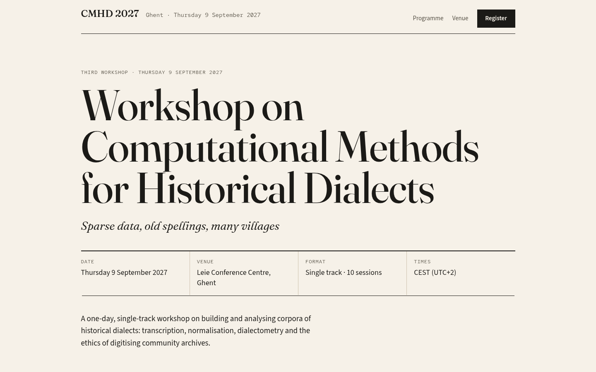

**[Full version US$39](https://themes.formchime.com/themes/symposium-site/)**



# Astro Symposium Site Lite

A free, one-page website for a **single-day, single-track** workshop or symposium: cover with date and venue, a printed-style timetable, the speakers, the venue and a registration fee table. Fraunces, Source Sans 3 and Red Hat Mono on paper-coloured ground with one stamp red. Astro 7 + Tailwind 4, no JavaScript, Lighthouse 95+.

**MIT licensed** — use it for anything.

> The sample workshop (CMHD 2027 in Ghent), its speakers, institutions and address are **fictional**.

## Want the rest?
The full **[Astro Symposium Site](https://themes.formchime.com/themes/symposium-site/)** adds a multi-day, multi-track timetable (rooms × times) with day/track/format filters in the URL, a page for every session and speaker linked both ways, `.ics` calendar files for each session and the whole programme, Event JSON-LD, call for papers with important dates, committee, sponsor tiers, venue & travel, tickets page, news, contact, privacy, and a print stylesheet that prints the programme one day per A4 page.

## Use
```bash
nvm use && npm install && npm run dev
```
Edit `src/event.config.ts` — that is the whole site. Recolour with `--stamp` in `src/styles/global.css`.

Build with `npm run build`; deploy `dist/` anywhere (Cloudflare Pages, Netlify, Vercel, GitHub Pages, a university server).
